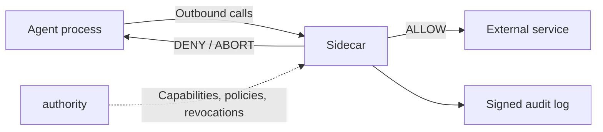

OpenFirma is a runtime boundary for AI agents. It does not judge the model's thoughts, prompts, or chain of reasoning. It controls the concrete thing an agent process eventually does: outbound traffic.

## Architecture



> **Intercepted call types:** plain HTTP, HTTPS (tunnel or transparent MITM), gRPC, Unix domain socket, and local shell commands via `local_exec`.

**Authority** is the trust root. It issues short-lived, cryptographically signed capability tokens for agents, loads Cedar policies from disk, and streams policy bundles and revocation updates to connected Sidecars over persistent gRPC connections. It sits entirely off the enforcement hot path: every allow/deny decision is made locally by the Sidecar without calling back to the Authority.

**Sidecar** is the local enforcement point. It intercepts every outbound call from the agent process, classifies it into a canonical action class, validates the capability token, evaluates Cedar policy, and on ALLOW injects credentials just-in-time. Fail-closed by construction: any error (unknown mapping, missing capability, stale policy, malformed request) produces a DENY.

**Audit emitter** runs as a background task inside the Sidecar. It signs and emits a record for every enforcement decision, capturing the agent, session, action class, target resource, the token that authorized the call, the outcome, and timing. Drains into pluggable destinations: stdout, file, remote service, or a local write-ahead log. Every record is independently verifiable.

## Managed mapping wire contract

The shared in-tree `firma-protobuf` crate defines a managed mapping extension to
`WatchPolicyBundle`. `PolicyBundle.mappings` is a complete snapshot of the
normalized rules from the Authority, sharing the policy and schema's
version and TTL. A present empty snapshot keeps protected traffic denied; missing
mappings are rejected by connected Sidecars.

Consumers advertise `ACTION_MAPPING_SNAPSHOT_V1` in
`WatchPolicyBundleRequest.supported_capabilities` on each connection. The managed
protocol requires the Authority to reject unsupported consumers before streaming
and the Sidecar to validate and atomically activate every component before
readiness. The [protobuf crate README](https://github.com/Firma-AI/openfirma/blob/main/crates/firma-protobuf/README.md#managed-mapping-snapshots)
specifies the wire representation and compatibility rules.

Managed Sidecars advertise the capability and activate policy and mapping
snapshots together. Invalid updates retain the accepted generation without
extending its lifetime. Any configured Authority URL selects this managed mode,
with or without credentials. The OpenFirma Authority loads mapping inputs from
`[authority].mapping_rules_paths` and publishes complete snapshots too. Every
Sidecar requires an Authority URL; endpoint-free operation is unsupported.
Authority configuration must select at least one mapping file. An explicitly
selected file with `rules = []` publishes a protected deny-all snapshot.

```toml
[authority]
mapping_rules_paths = ["mapping-rules.toml", "mappings/github.toml"]
```

Paths resolve relative to `firma.toml`. Mapping changes reload with policies and
schema under a new content version; an invalid reload retains the last valid
generation, which continues to receive periodic freshness refreshes. Mounted
configuration, such as a Kubernetes `ConfigMap` that publishes updates by
retargeting a `..data` symlink, reloads the same way. Any change beneath
`policy_dir` starts a reload, so keep files the Authority writes, such as its
log, outside that directory. Explicit
digit/wildcard port patterns such as `localhost:*` retain their port scope in
snapshots. Configured audit query-redaction names survive mapping replacement.

`firma config` and local `firma run` bootstrap configure these producer inputs.
Locally owned `firma run` Authorities receive frozen copies of the mapping files
in sealed per-run state, so an agent cannot edit a workspace mapping file to
change its active governance. Authored mapping changes apply on the next run;
independently launched Authority processes retain live reload. Oversized complete
snapshots are rejected before producer publication, preserving the last valid
generation.

Managed Composio requests must match a transport mapping from the pinned snapshot
before catalog-derived logical actions are enforced. Empty or nonmatching snapshots
block execution and discovery/control-plane passthrough. Matching discovery calls
retain their catalog passthrough semantics but require current readiness and a fresh
snapshot.

## Atomic runtime generations

The Sidecar pipeline pins a compiled snapshot at the start of each request.
That snapshot contains the mapping table and protection posture, policy evaluator
and compiled entity schema, bundle version, and freshness deadline. A concurrent
update cannot change classification or policy halfway through that request, and
the recorded bundle version comes from the same pin. Composite requests retain
one generation across all child evaluations.

Publication replaces the whole snapshot atomically. Existing requests retain
their original deadline; acquiring a snapshot does not renew its TTL. Authority
stream updates replace mappings and policy together, preserving configured query
redaction. Sidecars reject policy-only updates; an empty mapping snapshot
explicitly denies unmatched HTTP traffic. Envelope paths and audit resources/reasons share
query-name redaction with the `[REDACTED]` placeholder, including locally
configured sensitive query names.
Before returning an admitted decision, the pipeline rechecks that pin's freshness
after credential injection. Expiry during the wait denies the request; for a
composite request it blocks the entire transport, even if a fresh replacement
generation has arrived.

## The four invariants

These invariants explain behaviors you will encounter while working with OpenFirma.

### Fail closed

**What:** For protected traffic, uncertainty becomes a DENY outcome. Unknown mapping, missing capability, expired token, stale policy, unavailable policy evaluator, malformed request, failed credential fetch: all of these block the request. 

**Example:** If you add a new SaaS endpoint but forget to add a mapping rule, production should discover that as a denial, not silently let the agent reach it.

### No network on the hot path

**What:** Capability validation and Cedar policy evaluation use local Sidecar state. The Sidecar does not ask the Authority during each request decision. The invariant is about authorization: the decision to allow or deny does not depend on a request-time network round trip to the control plane. 

**Example:** If for some reason the Authority connection drops, the Sidecar can continue using fresh local state until freshness checks say the policy or revocation state is no longer trustworthy. At that point it denies.

### Determinism

**What:** The enforcement decision is deterministic for the same normalized request, local capability state, runtime signals, and policy bundle. There is no LLM or probabilistic classifier in the Sidecar decision path.

**Example:** If a request was denied because `action_count` exceeded a policy threshold, you can inspect the audit event and the bundle to understand why. You are not trying to reproduce a model judgment.

If a request was denied, you can inspect the audit event and the Cedar bundle and reproduce the exact decision. You are not debugging a model judgment.

**What:** The Sidecar builds a canonical `ExecutionEnvelope` for the action being evaluated. Policy sees that envelope. Audit records that envelope. Later steps such as credential injection and connector dispatch use derived data rather than rewriting what policy saw.

**Example:** Adding an `Authorization` header after policy allows a request does not change the action class, resource, or parameters that Cedar evaluated.

The Sidecar builds a canonical `ExecutionEnvelope` once, before enforcement. Policy evaluates that envelope. Audit records that envelope. Credential injection happens after the decision and does not rewrite what policy saw.

## Why this shape matters

The architecture gives OpenFirma a narrow job: govern outbound agent actions at the process boundary. The Sidecar does not need to understand every model, framework, prompt, or tool protocol. It needs to see the outbound request, classify it into a stable action vocabulary, validate local authority material, evaluate policy, and leave a signed audit trail.

## Where to go next

- [The enforcement pipeline](../pipeline/) explains the request path stage by stage.
- [Action classes](../action-classes/) explains how raw HTTP requests become policy vocabulary.
- [The sandbox boundary](../sandbox/) explains when `firma run` becomes relevant to the architecture.
