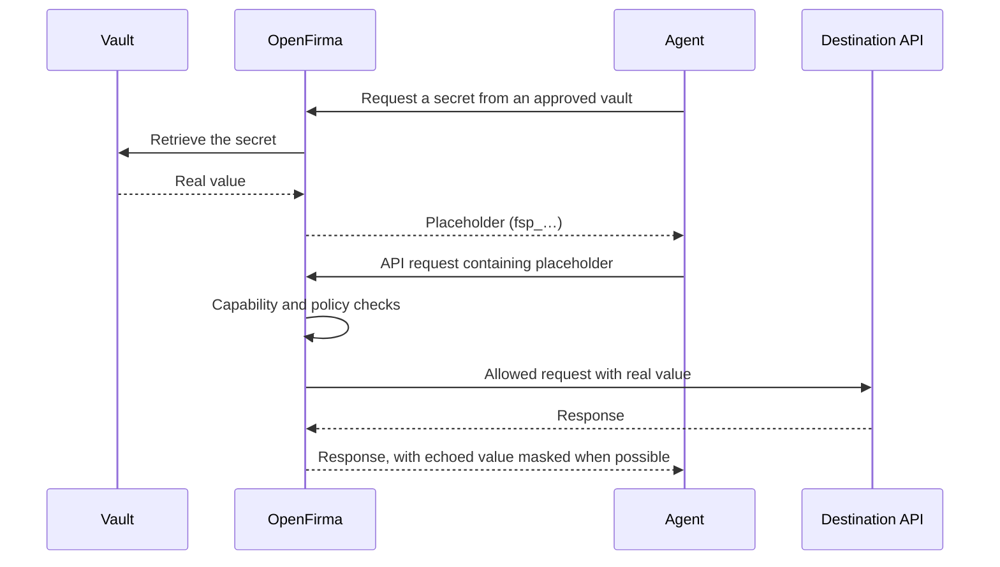

Agents often need credentials to call APIs, databases, and other services. The
usual approaches give the agent too much access:

- putting a secret in an environment variable gives the agent the plaintext;
- giving the agent a vault token lets it retrieve secrets directly; and
- returning a secret from a vault command leaves it in the agent's context and
  output.

OpenFirma separates **getting a reference** from **using the secret**. The agent
works with an opaque placeholder such as `fsp_…`; the normal workflow keeps the
retrieved value outside the agent and substitutes it only when an allowed
request is sent.

## The workflow



In practice:

1. The agent uses an approved vault command or vault API.
2. OpenFirma returns a placeholder instead of the secret value.
3. The agent puts that placeholder in the body of a request.
4. Capability and policy checks decide whether the request may proceed.
5. OpenFirma replaces the placeholder immediately before sending the allowed
   request to its destination.
6. If the destination echoes the value in its response, OpenFirma masks it
   back to the placeholder when possible.

The placeholder is a reference, not permission. It does not bypass capability
or Cedar policy checks.

## A simple built-in example

OpenFirma includes integrations for
[1Password](https://developer.1password.com/docs/cli/) (`op`),
[Bitwarden Secrets Manager](https://bitwarden.com/help/secrets-manager-cli/)
(`bws`), [HashiCorp Vault](https://developer.hashicorp.com/vault/docs/commands)
(`vault`), and [Doppler](https://docs.doppler.com/docs/cli) (`doppler`). To use
1Password, install the `op` CLI on the host and create an item with an API-key
field and `http://service.test` in its URLs. Then add one line to `firma.toml`:

```toml
[run.defaults]
secret_providers = ["op"]
```

Start the agent with a 1Password service-account token available to OpenFirma:

```bash
OP_SERVICE_ACCOUNT_TOKEN=ops_... firma run --profile generic -- your-agent
```

`OP_SERVICE_ACCOUNT_TOKEN` is available to OpenFirma, but `firma run` removes it
from the agent's environment before launch. The agent receives placeholders,
not the 1Password service-account token.

Built-in CLI providers require Linux `bwrap` or macOS VZ guest mode. See the
[supported backends](../../guides/secret-gateway/#provider-forms) before using
another runtime mode.

When the agent requests an item, it sees placeholders in place of supported
field values:

```bash
op item get "API credential"
```

```json
{
  "fields": [
    { "label": "api-key", "value": "fsp_01hz8k7g3v9m2q4x6r1n0p5t8w" }
  ]
}
```

The agent can then use the placeholder in an allowed request:

```http
POST http://service.test/use
Content-Type: application/json

{"api_key":"fsp_01hz8k7g3v9m2q4x6r1n0p5t8w"}
```

The destination receives the real value. The agent continues working with the
placeholder. This simplified request uses plain HTTP to focus on the secret
flow; production HTTPS requires [HTTPS
interception](../../guides/https-mitm/) for body substitution.

## Two ways to provide secrets

Use **secret providers** when an agent needs to select values dynamically from a
vault. The placeholder workflow keeps retrieval and use separate.

Use [credential injection](../../guides/inject-credentials/) when one fixed
credential should always be attached to requests for a known host. In that
case, the agent does not need to request or handle a placeholder.

## Go deeper

- [Configure secret providers](../../guides/secret-gateway/) for the managed
  workflow, HTTP vaults, and operational guidance.
- [Secret provider reference](../../guides/secret-provider-reference/) for
  built-in command support, custom matchers, scoping, limits, and edge cases.
- [Enable HTTPS MITM](../../guides/https-mitm/) when OpenFirma must inspect
  encrypted HTTP traffic.
- [Full-custom CLI example](https://github.com/Firma-AI/openfirma/tree/main/examples/custom-cli-secret)
  for a runnable local provider and agent.
- [Full-custom HTTP example](https://github.com/Firma-AI/openfirma/tree/main/examples/custom-http-secret)
  for vault-response placeholders and later rehydration.

Secret masking reduces accidental exposure; it is not a general data-loss
prevention system. See the [reference
boundaries](../../guides/secret-provider-reference/#compression-and-masking-limits)
before relying on masking for a production threat model.
